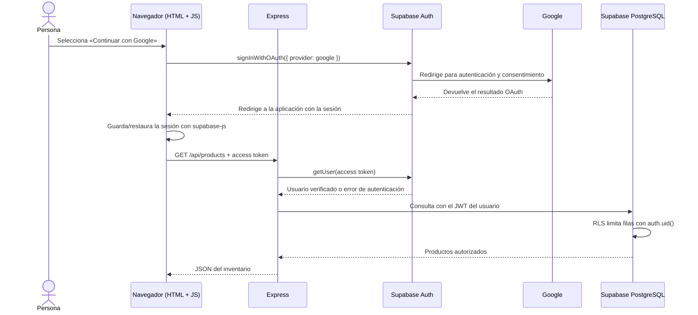
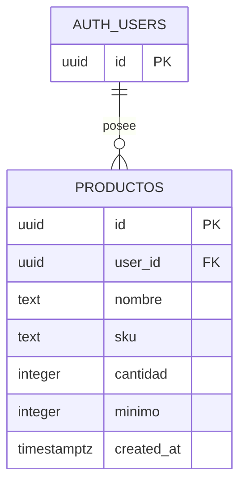

# Diseño técnico de Mini Inventario

## Objetivo y decisiones

Aplicación web para que cada persona acceda con Google, administre sus propios productos y detecte productos cuya cantidad sea menor que su mínimo. Express sirve el HTML, CSS y JavaScript sin framework, y expone una API JSON. Supabase proporciona Auth y PostgreSQL.

El navegador autentica a la persona con Supabase Auth y envía su access token como `Authorization: Bearer <token>` a la API. Express valida el token y usa ese mismo token al consultar la base de datos, de modo que Postgres también aplica Row Level Security (RLS). No se usa una clave `service_role` en el flujo de la aplicación.

Se conserva Google como proveedor de inicio de sesión, de acuerdo con el alcance acordado anteriormente. La integración OAuth se configura en Supabase Auth; el callback del proveedor vuelve a Supabase y Supabase redirige a la aplicación.

## Componentes y flujo

```text
Navegador (HTML + JS) ── GET / ──> Express ── sirve /public
        │
        ├── Supabase Auth: Google OAuth, sesión y cierre de sesión
        │
        └── API JSON + access token ──> Express ── JWT de usuario ──> Supabase PostgreSQL
                                                                    ├── Constraints e índices
                                                                    └── RLS por auth.uid()
```

- **Express:** sirve `public/`, entrega la configuración pública de Supabase y expone las rutas de productos. Puede organizarse en `src/server.js`, `src/routes/products.js`, `src/middleware/auth.js` y `src/lib/supabase.js`.
- **Cliente web:** HTML semántico, CSS y JavaScript modular, sin framework. El SDK `@supabase/supabase-js` gestiona OAuth y la sesión. La sesión persistida por el SDK permite restaurar la vista al recargar.
- **Supabase Auth:** gestiona Google OAuth, emisión/renovación de sesión y cierre de sesión. El cliente envía a Express el access token vigente.
- **PostgreSQL:** guarda los productos y aplica restricciones de integridad, unicidad y aislamiento de filas.

### Flujo de inicio de sesión



Si el token expiró, el SDK intenta renovarlo; la solicitud a la API se envía con el access token vigente. Si no puede obtener una sesión válida, se muestra el acceso y no se llama a la API protegida.

### Contrato mínimo de API

Todas las rutas `/api` requieren un access token vigente. Los cuerpos JSON de escritura solo admiten `nombre`, `sku`, `cantidad` y `minimo`; el servidor asigna `user_id` y la base asigna `id` y `created_at`.

| Método y ruta | Resultado |
| --- | --- |
| `GET /api/products` | Lista los productos de la persona autenticada, ordenados por nombre. Incluye un campo derivado `bajo_minimo` (`cantidad < minimo`). |
| `POST /api/products` | Crea un producto y devuelve el registro creado. |
| `PATCH /api/products/:id` | Actualiza nombre, SKU, cantidad y mínimo de un producto propio. |
| `DELETE /api/products/:id` | Elimina un producto propio; devuelve `204` si se eliminó. |

Respuestas previsibles: `400` para entrada inválida, `401` si falta o no es válido el token, `404` si el registro no existe o no pertenece a la persona, `409` si el SKU ya existe en su inventario y `500` para errores inesperados. Los mensajes públicos no deben incluir tokens, SQL ni detalles internos.

## Modelo de datos

Una migración SQL crea `public.productos`. Los SKU se normalizan en Express con `trim` y mayúsculas; el índice funcional mantiene la unicidad incluso si otro cliente omite esa normalización. `created_at` representa el alta y no se modifica en una actualización.

```sql
create table public.productos (
  id uuid primary key default gen_random_uuid(),
  user_id uuid not null references auth.users(id) on delete cascade,
  nombre text not null
    check (char_length(btrim(nombre)) between 1 and 120),
  sku text not null
    check (char_length(btrim(sku)) between 1 and 80),
  cantidad integer not null default 0 check (cantidad >= 0),
  minimo integer not null default 0 check (minimo >= 0),
  created_at timestamptz not null default now()
);

create unique index productos_user_sku_unique
  on public.productos (user_id, upper(btrim(sku)));

create index productos_user_id_idx on public.productos (user_id);
```

### Diagrama de la tabla



### RLS y permisos

Habilitar RLS y conceder a `authenticated` solo las operaciones necesarias. Crear políticas separadas para lectura, inserción, actualización y eliminación:

```sql
alter table public.productos enable row level security;

create policy "Cada persona lee sus productos"
  on public.productos for select to authenticated
  using ((select auth.uid()) = user_id);

create policy "Cada persona crea sus productos"
  on public.productos for insert to authenticated
  with check ((select auth.uid()) = user_id);

create policy "Cada persona actualiza sus productos"
  on public.productos for update to authenticated
  using ((select auth.uid()) = user_id)
  with check ((select auth.uid()) = user_id);

create policy "Cada persona elimina sus productos"
  on public.productos for delete to authenticated
  using ((select auth.uid()) = user_id);
```

La API no acepta `user_id` del cuerpo. En altas, Express toma el UUID del usuario autenticado y lo asigna al registro. En consultas y mutaciones la política RLS vuelve a limitar el acceso al propietario, aunque una ruta olvide filtrar por `user_id`.

## Validaciones por capa

| Capa | Validaciones y responsabilidad |
| --- | --- |
| Navegador | Comprueba campos requeridos, recorta espacios, limita nombre a 120 caracteres y SKU a 80, y exige enteros no negativos para cantidad y mínimo. Da respuesta inmediata en el formulario, pero no se considera una barrera de seguridad. Muestra como bajo mínimo únicamente si `cantidad < minimo`; la igualdad no alerta. |
| Supabase Auth | Completa el flujo OAuth de Google, verifica identidad y vigencia de sesión y renueva tokens según el ciclo del SDK. La API rechaza requests sin token vigente. |
| Express | Valida el esquema y tipos de cada body; rechaza campos extra, strings vacíos tras `trim`, valores no enteros, negativos, `NaN`, `Infinity` y valores fuera del rango de enteros PostgreSQL. Normaliza SKU con `trim().toUpperCase()`. Valida UUID de ruta, limita JSON entrante y no permite que el cliente elija `user_id`, `id` ni `created_at`. Valida el access token con `supabase.auth.getUser(token)` antes de operar. Convierte conflictos de unicidad a `409` y no expone errores internos. |
| PostgreSQL | `NOT NULL`, checks de texto y cantidades, tipos UUID/integer/timestamptz y FK a `auth.users` protegen la integridad incluso si se omite la API. Índice único por usuario y SKU normalizado impide duplicados concurrentes. RLS filtra y autoriza cada fila usando `auth.uid()`. |

La cantidad puede ser cero; el mínimo también. El valor exacto del mínimo se considera suficiente y no se marca como bajo. La unicidad del SKU no distingue mayúsculas y minúsculas dentro de una misma cuenta, pero permite repetir un SKU entre cuentas diferentes.

## Configuración y secretos

- Servidor: `SUPABASE_URL`, `SUPABASE_PUBLISHABLE_KEY` y `PORT` en variables de entorno. La publishable key no es un secreto; nunca usar la secret/service-role key en navegador ni en las rutas ordinarias de la API.
- Navegador: Express entrega `SUPABASE_URL` y la publishable key desde una ruta de configuración pública; no expone credenciales privadas.
- Supabase Dashboard: activar Google en Auth Providers; configurar las credenciales OAuth de Google y permitir en Redirect URLs la URL de callback local y de producción.
- Añadir `.env` al ignore de Git. Usar HTTPS en producción y no registrar access tokens ni cuerpos que puedan contener credenciales.

## Criterios de aceptación técnica

- Una persona sin sesión no puede usar la API ni leer productos desde la API de datos de Supabase.
- Dos cuentas distintas pueden crear el mismo SKU, pero una cuenta no puede repetirlo con diferencias de mayúsculas o espacios.
- Intentos de lectura, actualización o eliminación cruzados entre usuarios no revelan ni modifican los registros ajenos.
- Valores vacíos, negativos, fraccionarios, no numéricos o fuera de rango son rechazados en la API; las constraints de PostgreSQL mantienen la misma integridad.
- Al guardar cambios, el estado derivado de bajo mínimo se actualiza; `cantidad = minimo` no queda marcado.
- La eliminación de una cuenta de Auth elimina sus productos mediante la FK con `on delete cascade`.

## Referencias

- [Supabase Auth: Google](https://supabase.com/docs/guides/auth/social-login/auth-google)
- [Supabase JavaScript: obtener usuario autenticado](https://supabase.com/docs/reference/javascript/auth-getuser)
- [Supabase: Row Level Security](https://supabase.com/docs/guides/database/postgres/row-level-security)
