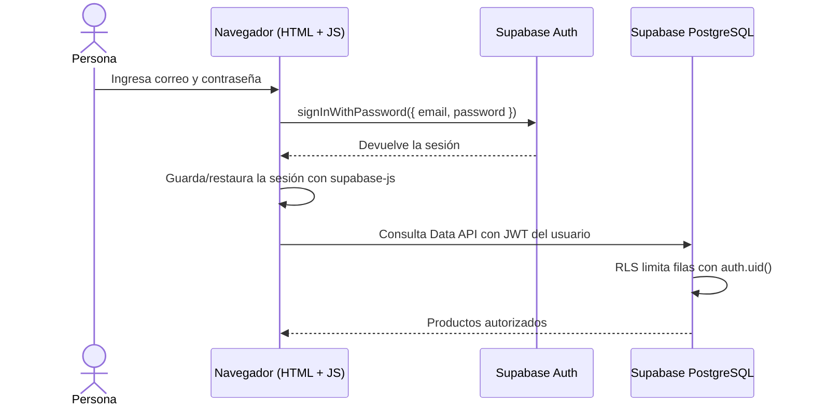
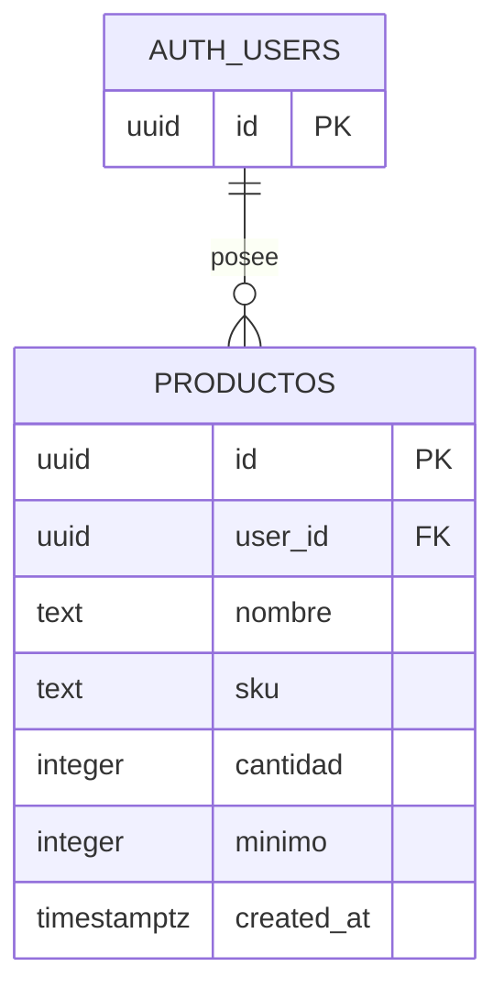

# Diseño técnico de Mini Inventario

## Objetivo y decisiones

Aplicación web para que cada persona se registre e inicie sesión con correo y contraseña, administre sus propios productos y detecte productos cuya cantidad sea menor que su mínimo. Express sirve el HTML, CSS y JavaScript sin framework. Supabase proporciona Auth, la API de datos y PostgreSQL.

El navegador autentica a la persona con Supabase Auth y consulta `public.productos` con el SDK oficial y una clave pública. PostgreSQL aplica Row Level Security (RLS) en cada solicitud. No se usa una clave `service_role` en la aplicación.

El alcance del Día 4 usa registro, inicio y cierre de sesión con correo y contraseña. La confirmación de correo depende de la configuración de Supabase Auth.

## Componentes y flujo

```text
Navegador (HTML + JS) ── GET / ──> Express ── sirve /public
        │
        ├── Supabase Auth: correo y contraseña, sesión y cierre de sesión
        │
        └── supabase-js + clave pública ──> Supabase Auth / Data API
                                           └── PostgreSQL: constraints, índices y RLS por auth.uid()
```

- **Express:** sirve `public/`, el SDK instalado desde `node_modules` y `/config.js`, que publica solo URL y clave pública.
- **Cliente web:** HTML semántico, CSS y JavaScript modular, sin framework. El SDK `@supabase/supabase-js` gestiona credenciales y sesión. La sesión persistida por el SDK permite restaurar la vista al recargar.
- **Supabase Auth:** gestiona registro, inicio de sesión con contraseña, emisión/renovación de sesión y cierre de sesión.
- **PostgreSQL:** guarda los productos y aplica restricciones de integridad, unicidad y aislamiento de filas.

### Flujo de inicio de sesión y consulta de productos



Si el token expiró, el SDK intenta renovarlo. Si no puede obtener una sesión válida, se muestra el acceso y la tabla no devuelve productos.

### Operaciones de datos

El SDK consulta la tabla después de validar campos en el navegador. En los inserts el cliente toma el ID desde la sesión; RLS y `WITH CHECK` aseguran que no se pueda asignar otro propietario. La base asigna `id` y `created_at`.

El SDK lista por nombre y permite insertar, editar y eliminar. Un SKU duplicado se rechaza mediante el índice único de PostgreSQL. El estado de mínimo se deriva en la interfaz (`cantidad < minimo`).

## Modelo de datos

Una migración SQL crea `public.productos`. Los SKU se normalizan en el cliente con `trim` y mayúsculas; el índice funcional mantiene la unicidad aunque otro cliente omita esa normalización. `created_at` representa el alta y no se modifica en una actualización.

```sql
create table public.productos (
  id uuid primary key default gen_random_uuid(),
  user_id uuid not null references auth.users(id) on delete cascade,
  nombre text not null
    check (char_length(btrim(nombre)) between 1 and 120),
  sku text not null
    check (char_length(btrim(sku)) between 1 and 80),
  cantidad integer not null default 0 check (cantidad >= 0),
  minimo integer not null default 0 check (minimo >= 0),
  created_at timestamptz not null default now()
);

create unique index productos_user_sku_unique
  on public.productos (user_id, upper(btrim(sku)));

create index productos_user_id_idx on public.productos (user_id);
```

### Diagrama de la tabla



### RLS y permisos

La migración habilita RLS, revoca privilegios de `anon`, concede a `authenticated` las cuatro operaciones de inventario y crea políticas separadas:

```sql
alter table public.productos enable row level security;
revoke all on public.productos from anon;
grant select, insert, update, delete on public.productos to authenticated;

create policy "Cada persona lee sus productos"
  on public.productos for select to authenticated
  using ((select auth.uid()) = user_id);

create policy "Cada persona crea sus productos"
  on public.productos for insert to authenticated
  with check ((select auth.uid()) = user_id);

create policy "Cada persona actualiza sus productos"
  on public.productos for update to authenticated
  using ((select auth.uid()) = user_id)
  with check ((select auth.uid()) = user_id);

create policy "Cada persona elimina sus productos"
  on public.productos for delete to authenticated
  using ((select auth.uid()) = user_id);
```

En altas, el cliente usa el ID de la sesión de Auth. RLS y `WITH CHECK` garantizan en PostgreSQL que corresponda al usuario autenticado, también si alguien modifica una solicitud desde las herramientas del navegador.

## Validaciones por capa

| Capa | Validaciones y responsabilidad |
| --- | --- |
| Navegador | Comprueba campos requeridos, recorta espacios, limita nombre a 120 caracteres y SKU a 80, y exige enteros no negativos para cantidad y mínimo. Da respuesta inmediata en el formulario, pero no se considera una barrera de seguridad. Muestra como bajo mínimo únicamente si `cantidad < minimo`; la igualdad no alerta. |
| Supabase Auth | Completa registro e inicio con correo y contraseña, verifica identidad y vigencia de sesión y renueva tokens según el ciclo del SDK. |
| Cliente | Normaliza SKU con `trim().toUpperCase()` y obtiene el usuario desde la sesión del SDK; no acepta `user_id` del formulario. La validación del cliente no es una barrera de seguridad. |
| PostgreSQL | `NOT NULL`, checks de texto y cantidades, tipos UUID/integer/timestamptz y FK a `auth.users` protegen la integridad. Índice único por usuario y SKU normalizado impide duplicados concurrentes. RLS filtra y autoriza cada fila usando `auth.uid()`. |

La cantidad puede ser cero; el mínimo también. El valor exacto del mínimo se considera suficiente y no se marca como bajo. La unicidad del SKU no distingue mayúsculas y minúsculas dentro de una misma cuenta, pero permite repetir un SKU entre cuentas diferentes.

## Configuración y secretos

- Servidor: `SUPABASE_URL`, `SUPABASE_KEY` y `PORT` en variables de entorno. `SUPABASE_KEY` debe ser una clave pública `publishable` o `anon`; `/config.js` rechaza claves secret y `service_role`.
- Navegador: Express entrega `SUPABASE_URL` y la publishable key desde una ruta de configuración pública; no expone credenciales privadas.
- Supabase Dashboard: configurar confirmación de correo y URLs permitidas según el entorno.
- Añadir `.env` al ignore de Git. Usar HTTPS en producción y no registrar access tokens ni cuerpos que puedan contener credenciales.

## Criterios de aceptación técnica

- Una persona sin sesión no puede leer productos desde la Data API de Supabase.
- Dos cuentas distintas pueden crear el mismo SKU, pero una cuenta no puede repetirlo con diferencias de mayúsculas o espacios.
- Intentos de lectura, actualización o eliminación cruzados entre usuarios no revelan ni modifican los registros ajenos.
- Valores vacíos, negativos, fraccionarios, no numéricos o fuera de rango se rechazan en el cliente; las constraints de PostgreSQL mantienen la integridad crítica.
- Al guardar cambios, el estado derivado de bajo mínimo se actualiza; `cantidad = minimo` no queda marcado.
- La eliminación de una cuenta de Auth elimina sus productos mediante la FK con `on delete cascade`.

## Referencias

- [Supabase Auth: registro con correo](https://supabase.com/docs/reference/javascript/auth-signup)
- [Supabase JavaScript: obtener usuario autenticado](https://supabase.com/docs/reference/javascript/auth-getuser)
- [Supabase: Row Level Security](https://supabase.com/docs/guides/database/postgres/row-level-security)
